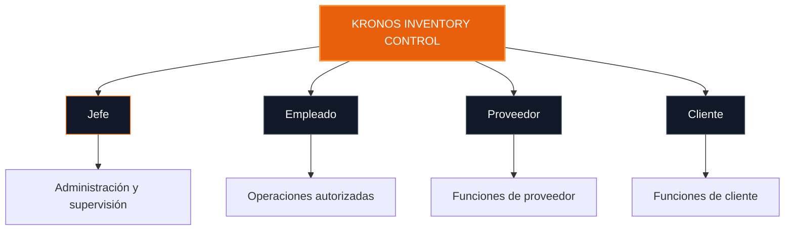
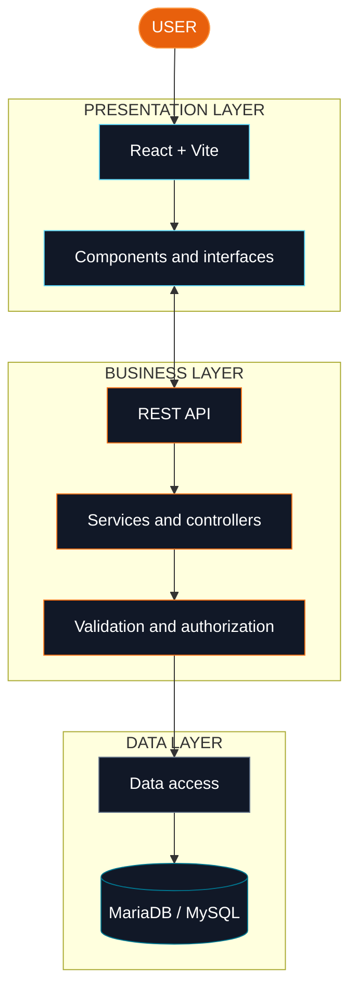
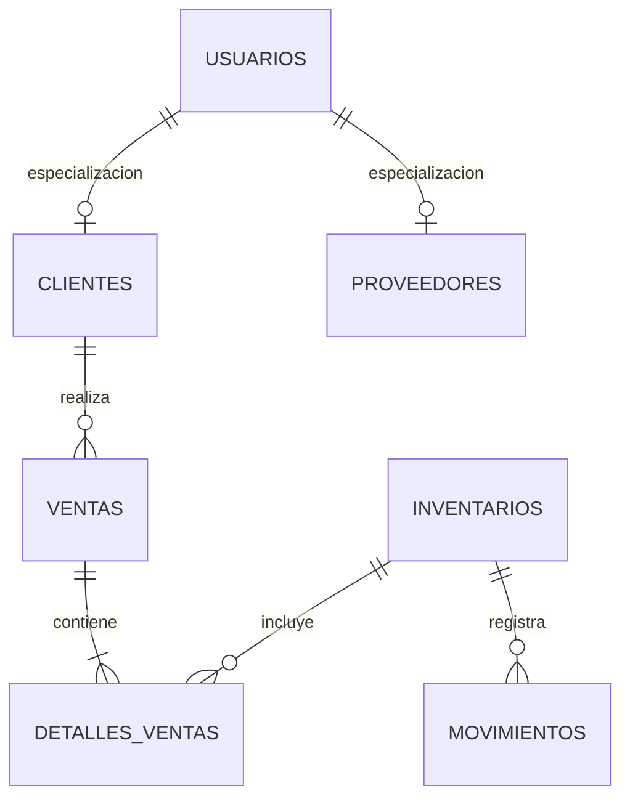
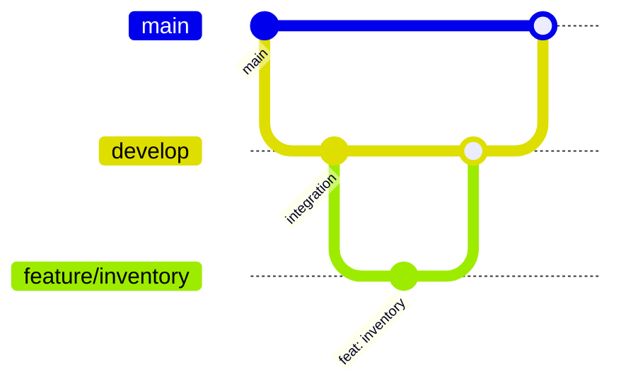

 <div align="center">


<br/>

<a href="#sobre-kronos"></a>
<a href="#arquitectura"></a>
<a href="#instalacion"></a>

<br/><br/>


<br/>


</div>

---

<div align="center">

### SYSTEM OVERVIEW

**A smarter way to manage inventory.**

KRONOS is a web-based inventory management system designed for **Ferretería y Perfilería Solmet**, focused on organizing materials, tracking stock movements, managing suppliers and purchase orders, and monitoring product warranties.

</div>

##  Sobre KRONOS

**KRONOS Inventory Control (KIC)** es un sistema de información desarrollado en el marco del programa Tecnólogo en Análisis y Desarrollo de Software del SENA.

Su propósito es transformar el manejo manual del inventario en un proceso digital más organizado, centralizado y fácil de consultar.

El sistema reúne las operaciones principales de la ferretería en una aplicación web, permitiendo estructurar la información de los productos, registrar movimientos y facilitar el seguimiento de los procesos de abastecimiento y garantías.

> **One system. Better visibility. Smarter inventory management.**

<div align="center">

|  |  |  |
|:---:|:---:|:---:|
| Stock management | Movement tracking | Centralized information |

</div>

##  Problemática y solución

### The challenge

La administración manual del inventario puede generar dificultades para conocer las existencias reales, identificar movimientos, consultar información de proveedores y realizar seguimiento a las garantías.

KRONOS propone centralizar estos procesos para mejorar la disponibilidad de la información y apoyar las actividades diarias de la ferretería.

<details>
<summary><b>Ver necesidades y soluciones</b></summary>

| Necesidad identificada | Solución propuesta |
|:--|:--|
| Dificultad para consultar existencias | Consulta centralizada del inventario. |
| Falta de claridad en los movimientos | Registro de entradas y salidas. |
| Productos difíciles de localizar | Clasificación y organización de materiales. |
| Información de proveedores dispersa | Gestión de proveedores. |
| Seguimiento del abastecimiento | Organización de órdenes de compra. |
| Garantías difíciles de rastrear | Registro y seguimiento de solicitudes. |
| Riesgo de quedarse sin existencias | Alertas de stock bajo y productos agotados. |

</details>

##  Funcionalidades principales

<div align="center">

<table>
<tr>
<td width="50%" valign="top">

###  Inventario

Administración y consulta de las existencias de los productos.

- Registro de entradas y salidas.
- Consulta de existencias.
- Seguimiento de movimientos.
- Identificación de stock bajo.
- Detección de productos agotados.

</td>
<td width="50%" valign="top">

###  Materiales

Organización de los productos y sus características.

- Registro y actualización.
- Consulta del catálogo.
- Clasificación por categorías.
- Organización por marcas, según el modelo implementado.
- Búsqueda de materiales.

</td>
</tr>
<tr>
<td width="50%" valign="top">

###  Proveedores

Gestión de la información relacionada con el abastecimiento.

- Registro y consulta de proveedores.
- Información asociada a cada proveedor.
- Seguimiento de órdenes de compra.
- Organización de estados de abastecimiento.

</td>
<td width="50%" valign="top">

###  Garantías

Organización y seguimiento de las solicitudes de garantía.

- Registro de solicitudes.
- Consulta de información.
- Seguimiento de estados.
- Evidencias cuando estén habilitadas.
- Control del proceso de resolución.

</td>
</tr>
</table>

</div>

### Stock status

<div align="center">


</div>

Los estados permiten identificar la disponibilidad de los materiales y facilitar su seguimiento. Los niveles y reglas de alerta deben corresponder a la configuración implementada en el sistema.

##  Roles del sistema



| Rol | Responsabilidad |
|:--|:--|
| Jefe | Supervisar y administrar las operaciones autorizadas. |
| Empleado | Ejecutar tareas internas según sus permisos. |
| Proveedor | Acceder a las funciones habilitadas para proveedores. |
| Cliente | Utilizar las funcionalidades disponibles para clientes. |

Los permisos finales dependen de las reglas de autorización configuradas en el backend.

##  <a id="arquitectura"></a>Arquitectura

KRONOS se orienta a una arquitectura cliente-servidor organizada en tres capas: presentación, lógica de negocio y acceso a datos.



### Design pattern: MVC

Se propone **Model–View–Controller (MVC)** para organizar las responsabilidades del backend:

| Componente | Función |
|:--|:--|
| Model | Gestiona la representación de los datos y su acceso. |
| View | Representa la presentación de la información. React se encarga de la interfaz del cliente. |
| Controller | Recibe las solicitudes y coordina las operaciones correspondientes. |

La arquitectura y el patrón deben verificarse contra la estructura definitiva del código antes de presentarlos como completamente implementados.

##  Tecnologías

<div align="center">

### FRONTEND


### DATABASE & BACKEND


### DEVELOPMENT TOOLS


</div>

| Tecnología | Aplicación |
|:--|:--|
| React | Interfaces basadas en componentes. |
| Vite | Desarrollo y compilación del frontend. |
| JavaScript | Lógica e interactividad. |
| Bootstrap | Estilos y componentes de interfaz. |
| MariaDB / MySQL | Persistencia de datos relacionales. |
| Git y GitHub | Versionamiento y colaboración. |
| Postman | Pruebas de servicios HTTP. |
| JWT | Autenticación prevista para los servicios protegidos. |
| Swagger / OpenAPI | Documentación prevista para la API REST. |

Los elementos que aún no estén integrados se consideran parte de la evolución técnica del proyecto.

##  Modelo de datos

La base de datos relacional organiza las entidades necesarias para gestionar usuarios, productos y operaciones.



### Entidades principales

| Tabla | Propósito |
|:--|:--|
| `usuarios` | Información general y autenticación. |
| `clientes` | Datos específicos de clientes. |
| `proveedores` | Información de proveedores. |
| `inventarios` | Productos y existencias. |
| `movimientos` | Entradas y salidas. |
| `ventas` | Operaciones de venta. |
| `detalles_ventas` | Productos asociados a las ventas. |
| `garantias` | Solicitudes y seguimiento de garantías. |

El esquema definitivo se encuentra en el script SQL vigente. Las relaciones del diagrama son conceptuales y deben contrastarse con las claves foráneas reales.

##  <a id="instalacion"></a>Instalación

### Requisitos previos


**01 — Clonar el repositorio**

```bash
git clone <URL_DEL_REPOSITORIO>
cd <CARPETA_DEL_FRONTEND>
```

**02 — Instalar dependencias**

```bash
npm install
```

**03 — Configurar la base de datos**

- Iniciar MariaDB/MySQL.
- Importar el script SQL vigente.
- Verificar las tablas y relaciones.
- Configurar las variables de entorno que requiera el backend.

**04 — Ejecutar el frontend**

```bash
npm run dev
```

Vite mostrará en la terminal la dirección local para abrir la aplicación.

> La ejecución completa requiere que los servicios de backend y la conexión a la base de datos estén configurados, cuando corresponda.

##  API REST y seguridad

La API REST permite comunicar la interfaz con los servicios de negocio y las operaciones sobre la base de datos.

| Método | Uso |
|:--|:--|
| `GET` | Consultar información. |
| `POST` | Crear recursos. |
| `PUT` | Reemplazar o actualizar un recurso. |
| `PATCH` | Actualizar parcialmente un recurso. |
| `DELETE` | Eliminar recursos cuando esté permitido. |

### Controles previstos

- Autenticación y autorización por roles.
- Validación de datos de entrada.
- Protección de rutas privadas.
- Configuración de CORS.
- Manejo uniforme de errores HTTP.
- Documentación de endpoints.
- Pruebas mediante Postman.

##  Flujo de desarrollo



### Convención de commits

```text
feat(inventario): agregar registro de movimientos
fix(proveedores): corregir validación de datos
style(login): mejorar diseño de autenticación
docs(kronos): actualizar documentación
refactor(api): organizar servicios
```

Se recomienda trabajar con ramas independientes por funcionalidad y revisar los cambios antes de integrarlos.

##  Estado del proyecto

<div align="center">

| Área | Estado |
|:--|:--:|
| Análisis y diseño | En evolución |
| Frontend React | En desarrollo |
| Base de datos relacional | En desarrollo |
| API REST | Por consolidar |
| Seguridad y autorización | Por validar |
| Pruebas y despliegue | Pendiente de consolidación |

</div>

El estado de cada funcionalidad debe actualizarse con base en el código, las pruebas y los entregables existentes.

##  Equipo de desarrollo

<div align="center">

**SENA · ADSO · Ficha 3315796**

| Integrante | Área de trabajo |
|:--|:--|
| Mariana Martínez | Proveedores y órdenes de compra |
| Erick Vásquez | Materiales y clasificación |
| Manuel Vigoya | Inventario, entradas, salidas y alertas |
| Evert Arias | Inventario, entradas, salidas y alertas |
| David Villanueva | Garantías |

</div>

---

<div align="center">


<br/>


<sub>KRONOS INVENTORY CONTROL · SENA ADSO</sub>

<sub>Designed to organize. Built to evolve.</sub>

</div>